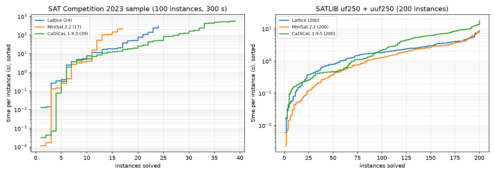
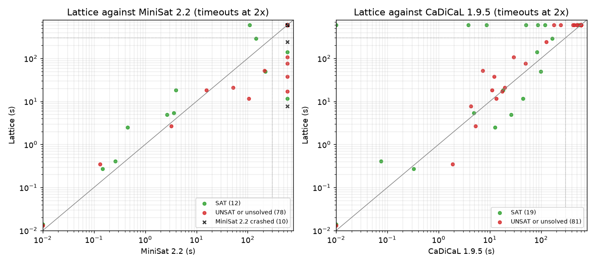

# Lattice

A CDCL SAT solver written from scratch in C++, a DRAT proof checker in Rust that verifies every
UNSAT answer, a Python benchmark harness against MiniSat and CaDiCaL, and a TypeScript page that
replays the solver's search on Sudoku, N-queens and pigeonhole formulas.



## Results

### SAT Competition 2023 sample: 100 instances, 300 s each

The instances are a seeded random sample (seed 2023) of the 246 main-track instances of the SAT
Competition 2023 with fewer than 300,000 clauses, as listed by the
[Global Benchmark Database](https://benchmark-database.de). The sample covers 31 families; 32 of the
instances are known SAT, 59 known UNSAT and 9 have no known result. The list is in
[bench/data/instances.json](bench/data/instances.json).

| Solver | Solved | SAT | UNSAT | PAR-2 (s) | Wrong answers |
|---|---:|---:|---:|---:|---:|
| CaDiCaL 1.9.5 | **39** | 19 | 20 | 415.5 | 0 |
| **Lattice** | **24** | 11 | 13 | 467.2 | 0 |
| MiniSat 2.2 | 17 | 10 | 7 | 506.7 | 0 |

- **Lattice against MiniSat:** Lattice solves 8 instances that MiniSat does not, and MiniSat
  solves 1 that Lattice does not.
- **Lattice against CaDiCaL:** CaDiCaL solves every instance Lattice solves, plus 15 more. These
  are mostly argumentation, set-covering and cryptography instances.
- **MiniSat crashes:** on 10 of the 100 instances, MiniSat crashed with an access violation
  instead of finishing (see [Caveats](#caveats)). Lattice and CaDiCaL solved only 2 of those 10.
  Even if MiniSat were credited with both, it would reach 19 solved, which is still fewer than
  Lattice.



Instances solved per family; families where no solver solved anything are left out:

| Family | Instances | Lattice | MiniSat | CaDiCaL |
|---|---:|---:|---:|---:|
| miter | 8 | 4 | 2 | 5 |
| mutilated-chessboard | 6 | 3 | 0 | 3 |
| planning | 4 | 4 | 3 | 4 |
| cryptography-ascon | 4 | 1 | 1 | 4 |
| argumentation | 8 | 0 | 0 | 3 |
| set-covering | 4 | 0 | 0 | 3 |
| cryptography | 3 | 2 | 2 | 2 |
| subgraph-isomorphism | 2 | 1 | 1 | 2 |
| quasigroup-completion | 2 | 1 | 1 | 2 |
| brent-equations | 2 | 0 | 0 | 1 |
| rbsat | 1 | 1 | 0 | 1 |
| grs-fp-comm, influence-maximization | 2 | 0 | 0 | 2 |
| 7 single-instance families | 7 | 7 | 7 | 7 |

None of the three solvers solved anything in the pigeon-hole, Tseitin, social-golfer,
interval-matching, register-allocation or cryptography-simon families. The full table is in
[results/summary.json](results/summary.json).

### SATLIB uf250 / uuf250: 200 random 3-SAT instances

These instances have 250 variables and 1,065 clauses each, at the satisfiability threshold; 100 are
SAT and 100 UNSAT.

| Solver | Solved | Total time (s) | Median, SAT (s) | Median, UNSAT (s) |
|---|---:|---:|---:|---:|
| MiniSat 2.2 | 200 | **362** | 0.43 | 2.54 |
| **Lattice** | 200 | 437 | 0.87 | 2.73 |
| CaDiCaL 1.9.5 | 200 | 746 | 0.47 | 6.0 |

- **Who is fastest:** all three solve every instance. MiniSat, the leanest of the three, is
  fastest both per instance and in total, and Lattice comes second.
- **Slowest instance:** 8.6 s for Lattice, 8.9 s for MiniSat and 17.8 s for CaDiCaL.
- **MiniSat crashes:** in the first pass MiniSat crashed on two of these instances. Both finished
  normally when re-run, and the table uses the re-run times (see [Caveats](#caveats)).
- **Ablation:** Lattice without variable elimination, with Luby restarts only, or with Glucose
  restarts only also solves all 200, with PAR-2 between 2.0 and 2.2 s. These small random
  instances do not separate the variants. An ablation on the competition sample would have taken
  about three more hours of machine time and was not run.

### Every answer is checked

- **SAT answers:** every model, from all three solvers, is checked against the original formula
  in Python. The Lattice binary also checks its own model before printing it. No bad model
  appeared.
- **UNSAT answers:** every Lattice UNSAT answer is checked by `lattice-check`, the Rust DRAT
  checker, using the binary DRAT proof the solver wrote during the run. That proof also covers
  preprocessing: every resolvent added and every clause removed by variable elimination is in it.
  - Competition sample: **13 of 13** proofs verified.
  - SATLIB: **100 of 100** verified, plus **300 of 300** in the ablation runs.
- **Known results:** answers are compared with the known SAT/UNSAT result where one exists. No
  solver gave a wrong answer.

| Proof checking | Competition (13 proofs) | SATLIB (100 proofs) |
|---|---:|---:|
| Median proof size | 33.6 MB | 5.0 MB |
| Largest proof | 284 MB | 11.7 MB |
| Median check time ÷ solve time | 3.1 | 2.0 |
| Slowest check | 1,494 s (solved in 244 s) | 24 s |

Checking a proof costs more than finding it, as it does with drat-trim; mutilated-chessboard proofs
are the most expensive.

## How it works

### Solver (C++, `solver/src`, about 1,300 lines)

- **Data structures:** a clause arena (header, activity, literals) with two watched literals per
  clause. Watch lists hold blocker literals, and binary clauses are marked inside the watch lists.
- **Conflict analysis:** 1-UIP learning with recursive clause minimisation (MiniSat's
  abstract-level filter).
- **Decisions:** VSIDS on a binary heap, with a decay that ramps from 0.80 to 0.95, and phase
  saving.
- **Restarts:** there are two kinds.
  - Glucose: compares a fast and a slow moving average of the LBD (restart when fast > 1.25 ×
    slow), and blocks a restart when the trail is 1.4 × its average.
  - Luby: unit of 100 conflicts.

  The default mode alternates focused (Glucose) and stable (Luby) phases of doubling length.
- **Learnt-clause database:** three tiers by LBD. Clauses with LBD ≤ 2 are kept forever; clauses
  with LBD ≤ 6 are kept while they keep being used; for the rest, the half with the lowest
  activity is deleted every 2,000 + 300·k conflicts. Arena garbage collection uses forwarding
  addresses.
- **Preprocessing:**
  - subsumption and self-subsuming resolution;
  - bounded variable elimination: a variable is eliminated only if the resolvents are no more
    than the clauses they replace, with at most 20 literals each;
  - an elimination stack used to extend the model to the eliminated variables;
  - every step is written to the DRAT proof.
- **Output:** DRAT proofs in binary or text form. An optional JSONL trace of decisions,
  assignments with their reasons, conflicts, learnt clauses, backjumps and restarts.

```
lattice [--proof out.drat] [--text-proof] [--no-elim] [--restarts auto|glucose|luby]
        [--timeout s] [--trace out.jsonl] [--quiet] file.cnf
```

The command prints `s SATISFIABLE` with `v` lines, `s UNSATISFIABLE` or `s UNKNOWN`, exits with
10, 20 or 0, and ends with a `c stats {...}` JSON line.

### DRAT checker (Rust, `checker`)

The checker checks backwards, like drat-trim:
- **Forward pass:** adds the formula and the proof's lemmas with top-level unit propagation until a
  conflict appears. Deletions of unit clauses and reason clauses are ignored, as drat-trim does.
- **Backward pass:** marks the clauses that the final conflict depends on, and checks only the
  marked lemmas. Each is checked by RUP, and if that fails, by RAT on its first literal.

Clauses that are not active have their watches dropped; the watches are re-attached when the
backward pass reaches the clause's deletion. This change made the checker about 3–4 times faster
on large proofs.

```
lattice-check formula.cnf proof.drat     # prints "s VERIFIED" (exit 0) or "s NOT VERIFIED" (exit 1)
```

### Benchmark harness (Python, `bench/lattice_bench`)

- **`fetch.py`:** queries GBD and downloads the seeded sample (`--satlib` downloads the two SATLIB
  sets).
- **`run.py`:** runs each solver on each instance in its own process, 6 at a time; the runs can be
  resumed.
  - For Lattice, it writes the proof, checks it and then deletes it.
  - MiniSat and CaDiCaL come from PySAT 1.9.dev21 (`minisat22`, `cadical195`), interrupted by a
    timer after 300 s.
- **`report.py`:** writes `results/summary.json` and the plots.
- **`puzzles.py`:** encodes the visualisation's puzzles and writes their traces.

**Timing:** times are solving time only. Reading the file is not counted for any solver; Lattice's
time includes its preprocessing.

**Machine:** an Intel Core i7-10870H (8 cores) with 16 GB of RAM, running Windows 11.

### Visualisation (TypeScript, `web`)

`npm run dev` in `web/` opens a page that replays real solver traces event by event. It shows:
- the board, with every assignment coloured by its decision level and decisions outlined;
- a caption explaining each event;
- the decision-level curve over time;
- the decision stack;
- the last conflicting clause, with false literals struck through;
- the latest learnt clauses with their LBD and backjump level.

It has play, step, next-conflict and scrubbing controls.

| Trace | Variables | Clauses | Result | Decisions | Conflicts |
|---|---:|---:|---|---:|---:|
| 8 queens | 64 | 736 | SAT | 43 | 15 |
| 16 queens | 256 | 6,336 | SAT | 465 | 211 |
| 6 pigeons, 5 holes | 30 | 81 | UNSAT | 168 | 138 |
| Sudoku, 25 clues | 729 | 12,013 | SAT | 1 | 0 |
| Sudoku, 36 clues | 729 | 12,024 | SAT | 0 | 0 |

The Sudokus are generated with a unique solution. The standard encoding propagates so strongly that
unit propagation alone solves them: the 25-clue puzzle needs a single decision and no conflicts.
The page shows Sudoku as a demonstration of propagation, and N-queens and pigeonhole for the
search itself.

## Caveats

- **MiniSat crashes:** PySAT 1.9.dev21's MiniSat 2.2 (Windows, Python 3.14) crashed in two ways.
  - On formulas whose variable numbers have large gaps (for example 1,157 variables used out of
    58,317 declared), it crashed as soon as `solve()` was called. The harness now renumbers the
    variables to 1..n for MiniSat only, which keeps the formula equisatisfiable. The 20 affected
    runs were re-run with this fix; the other 80 MiniSat runs used the original numbering.
  - On 10 of those 20 runs, it still crashed partway through the search (exit code 0xC0000005).
    It also crashed on 2 of its 200 SATLIB runs, which finished normally when re-run, so the crash
    is intermittent.
    The crash also happens with a plain `solve()` and with a 128 MB stack. These runs count as
    unsolved and are marked as crashes in the plots and in `results/runs.jsonl`.

  Older PySAT releases have no wheels for Python 3.14, and building one from source would have
  meant downloading the solvers' source code, so no other MiniSat build was tried.
- **Proof checker comparison:** the proof checker was not compared with drat-trim, because
  downloading and building external code was not allowed in this environment. It is tested on its
  own:
  - unit tests with valid and invalid proofs;
  - every proof in the benchmark;
  - in CI, a pigeonhole proof is checked against a satisfiable variant of the formula, and the
    checker must reject it.
- **Solver gap:** CaDiCaL is far ahead on the competition sample. Lattice has none of its
  inprocessing (vivification, probing, bounded variable addition, chronological backtracking), and
  none of the three solvers handles parity (XOR) or cardinality reasoning, which is what the
  Tseitin and pigeon-hole families need.
- **Sample size:** a 100-instance sample of a single competition year is small; a few instances
  either way would change the margins.

## Building and testing

```bash
cmake -S . -B build -DCMAKE_BUILD_TYPE=Release
cmake --build build --config Release
ctest --test-dir build -C Release      # 1,600 random formulas against brute force, pigeonhole, edge cases
cd checker && cargo test --release     # valid and invalid RUP/RAT proofs, deletions
cd web && npm ci && npm test           # trace replay
```

To run the benchmark, use Python 3.14 with the packages in `bench/requirements.txt`:

```bash
cd bench
python -m lattice_bench.fetch && python -m lattice_bench.fetch --satlib
python -m lattice_bench.run --timeout 300 --jobs 6
python -m lattice_bench.run --suite satlib
python -m lattice_bench.report
```

**CI** builds and tests the solver on Ubuntu and Windows, tests the checker and the Python code,
checks a solver proof end to end (including the rejection case), and builds the page.

## License

MIT
